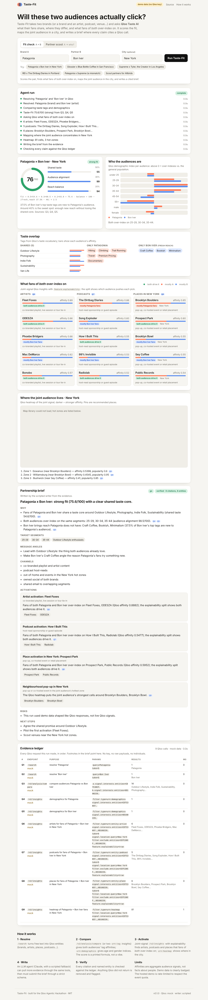

# Taste-Fit — a brand-partnership agent built on Qloo Taste AI

**Will these two audiences actually click?** Give Taste-Fit two brands (or a brand and an artist, podcast, venue, destination…) and it asks the Qloo Insights API what their fans share, where they differ, and what fans of *both* over-index on. It then

1. scores the partnership with a printed formula built only from Qloo signals,
2. finds concrete activations (artists, podcasts, places) that the *joint* audience over-indexes on, with Qloo's explainability showing which side drives each pick,
3. maps where the joint audience concentrates in a city (Qloo heatmap),
4. writes a decision-ready brief in which **every claim cites the Qloo call that supports it**, and
5. verifies the brief against that evidence ledger before showing it.

A second mode, **Partner scout**, asks Qloo which brands fans of A over-index on and scores the top candidates.



## Why this needs Qloo

Partnership and co-marketing decisions are usually made on vibes, follower counts or expensive panel surveys. None of those can answer "do the *fans* of Patagonia and the *fans* of Bon Iver share a taste core, and what else do they both like?" across brands, music, podcasts and places at once. Qloo's cross-domain affinity graph is the only input that can:

| Product question | Qloo capability used |
|---|---|
| What do the two audiences share, and where do they differ? | `/v2/analysis/compare` (tag affinities for audience A vs B), falling back to two `filter.type=urn:tag` insights |
| Are these the same people demographically? | `filter.type=urn:demographics` per entity |
| What would fans of **both** show up for? | joint-signal `/v2/insights` with `signal.interests.entities=A,B` and `feature.explainability=true` per target type |
| Where in the city should the activation be? | `filter.type=urn:heatmap` with `filter.location.query`, plus `urn:entity:place` with `filter.location.query` |
| Which partners should A even consider? | `urn:entity:brand` insights signalled by A, then a full score for each candidate |
| Free text → entity | `/search` with `types` |

The LLM in the loop does not invent any of this; it can only *ask for more Qloo evidence* through the same tools and must submit the brief through a strict schema. The verifier removes any entity the model names that Qloo did not return.

## The Taste-Fit score

All inputs are Qloo outputs, so each number traces back to a ledger entry:

```
shared_taste       = cosine(tag affinities of A, tag affinities of B) × 100
audience_alignment = (cosine(demographic index A, demographic index B) + 1) / 2 × 100
fresh_reach        = share of B's top-15 tags that are not in A's top-20 × 100
balance            = 100 − |fresh_reach − 40| × 2.5        (clipped to 0..100)
fit                = 0.5·shared_taste + 0.3·audience_alignment + 0.2·balance
```

≥70 strong · 55–69 workable · <55 weak. A taste clone scores high on shared taste but loses on balance (no new reach); an unrelated partner has reach but no shared core. The sweet spot is a partner that overlaps on a real core and extends the audience by roughly 30–50%.

## Agent design

```
UI (vanilla JS, SSE)  →  FastAPI  →  pipeline
                                      ├─ ToolBox over QlooClient  (live REST adapter | deterministic mock)
                                      ├─ Ledger  Q1..Qn  (endpoint, redacted params, counts, names, ms, cache)
                                      ├─ scoring.compute_fit
                                      ├─ writer: LLM agent loop (tools: recommend / heatmap / find_tags → finalize_brief, strict)
                                      │          or scripted writer (no key needed)
                                      └─ verifier (citations exist, entities exist in ledger, score/verdict consistency)
```

* **Evidence ledger.** Every Qloo request is numbered. The brief's footnotes, the activation cards and the map all point at ledger rows; the UI shows the request parameters (entity ids shortened) so the request-to-result path is visible without exposing payloads or the key.
* **Writer.** With `ANTHROPIC_API_KEY`, Claude (`claude-opus-5-5` by default, via the official SDK with strict tools and server-side fallbacks) writes the brief and may spend up to `LLM_MAX_TOOL_CALLS` extra Qloo calls. Any OpenAI-compatible endpoint (`OPENAI_BASE_URL`) works too, so free tiers are fine. With neither, the scripted writer produces the same structure from the evidence, so the product is complete without an LLM.
* **Verifier.** Unknown citations and invented entities are flagged; invented entities are removed from activations and listed as "removed (not in Qloo evidence)".
* **Quota guard.** Per-run call cap (`QLOO_MAX_CALLS_PER_RUN`, default 16), per-process daily budget (`QLOO_DAILY_BUDGET`), a 6-hour response cache, bounded retries honouring `Retry-After`, and a per-visitor rate limit. If live Qloo is unavailable the run reruns on demo data and says so.
* **Demo data.** `app/qloo/fixtures.json` is a small deterministic world (74 entities, 54 tags, 5 cities) shaped exactly like Qloo responses, so tests, CI and offline demos exercise the full flow. The UI badge always says which source was used.

## Run it

```bash
git clone https://github.com/kbns2000/taste-fit && cd taste-fit
python -m venv .venv && . .venv/bin/activate      # Windows: .venv\Scripts\activate
pip install -r requirements-dev.txt
cp .env.example .env                               # fill QLOO_API_KEY (and optionally an LLM key)
set -a; . ./.env; set +a                           # or export the variables your own way
uvicorn app.main:app --reload --port 7860          # open http://127.0.0.1:7860
python -m pytest                                   # 38 tests, mock data, no network
```

Without `QLOO_API_KEY` the app runs on demo data and the header badge says so. Hackathon keys use `https://hackathon.api.qloo.com` (the default); production keys set `QLOO_BASE_URL=https://api.qloo.com`.

`python scripts/smoke_live.py` exercises every live call shape once a key exists (about 8 requests) and prints the raw shape of the compare response.

### Docker / Hugging Face Space

```bash
docker build -t taste-fit . && docker run -p 7860:7860 -e QLOO_API_KEY=... taste-fit
# or, with a write token:
HF_TOKEN=... QLOO_API_KEY=... python deploy/hf_space.py --space <you>/taste-fit
```

The deploy script creates a Docker Space, stores keys as Space **secrets**, uploads the app and prints the URL. `.github/workflows/keepalive.yml` pings the Space twice a day if the repo variable `DEMO_URL` is set.

### Configuration

| Variable | Default | Meaning |
|---|---|---|
| `QLOO_API_KEY` | – | Qloo key; absent → demo data |
| `QLOO_BASE_URL` | `https://hackathon.api.qloo.com` | API host |
| `QLOO_MODE` | `auto` | `live` / `mock` to force a source |
| `QLOO_MAX_CALLS_PER_RUN` | `16` | per-run cap incl. LLM tool calls |
| `QLOO_DAILY_BUDGET` | `800` | per-process daily cap |
| `ANTHROPIC_API_KEY` / `ANTHROPIC_MODEL` / `ANTHROPIC_EFFORT` | – / `claude-opus-5-5` / `medium` | Claude writer |
| `OPENAI_API_KEY` / `OPENAI_BASE_URL` / `OPENAI_MODEL` | – | any OpenAI-compatible writer |
| `LLM_MODE` | `auto` | `anthropic` / `openai` / `off` |
| `LLM_MAX_TOOL_CALLS` | `12` | extra Qloo calls the writer may make |
| `LLM_DEADLINE_S` | `120` | writer time limit before the scripted writer takes over |
| `RUNS_PER_IP_PER_10MIN` | `8` | demo rate limit for agent runs |
| `LOOKUPS_PER_IP_PER_10MIN` | `60` | demo rate limit for type-ahead lookups |
| `MAX_ACTIVE_RUNS` | `12` | concurrent runs per process; more → HTTP 503 |

## API

| Route | Purpose |
|---|---|
| `GET /api/health` | source (live/mock), writer, quota status; never secrets |
| `GET /api/presets` | example pairs |
| `POST /api/resolve` | `{"query": "pata"}` → Qloo entity candidates |
| `POST /api/runs` | `{"mode":"fit"\|"scout","a","b","city"}` → `run_id` |
| `GET /api/runs/{id}` | state, events, result (fit, picks, zones, brief, verification, ledger) |
| `GET /api/runs/{id}/events` | Server-Sent Events of the agent's progress |

## Safe use and limits

* Qloo affinities are aggregate audience signals. Taste-Fit never sends or stores anything about individuals; inputs are public brand/artist names and a city.
* The key lives only in a server-side environment variable and only travels in the `X-Api-Key` header. It is never logged, never in the ledger, never in the browser.
* The score is a heuristic for prioritising conversations, not a forecast of campaign lift. Validate with a pilot.
* Demo-data runs are labelled; the demo world is small, so unknown names return "not found" rather than a guess.
* The exact shape of `/v2/analysis/compare` is not documented; the adapter parses it defensively and falls back to two tag-insight calls.

## Repository layout

```
app/config.py            settings from env (never prints secrets)
app/qloo/client.py       live Qloo REST adapter + shared QlooClient contract + CallRecord
app/qloo/mock.py         deterministic mock with the same contract
app/qloo/fixtures.json   demo world (built by scripts/build_fixtures.py)
app/scoring.py           Taste-Fit formula
app/agent/ledger.py      evidence ledger
app/agent/tools.py       tool box over the client, LLM tool schemas
app/agent/writer.py      scripted writer + LLM agent loop
app/agent/verifier.py    brief-vs-ledger checks
app/agent/pipeline.py    fit check / partner scout orchestration
app/agent/llm/           Anthropic SDK provider, OpenAI-compatible provider
app/main.py              FastAPI app, SSE, rate limiting
web/                     UI (index.html, styles.css, app.js, Leaflet map)
tests/                   38 tests (scoring, mock, live adapter with fake transport, API, agent loop, review regressions)
deploy/hf_space.py       Hugging Face Space deployment
```

Built for the Qloo Agentic Hackathon · MIT License.
